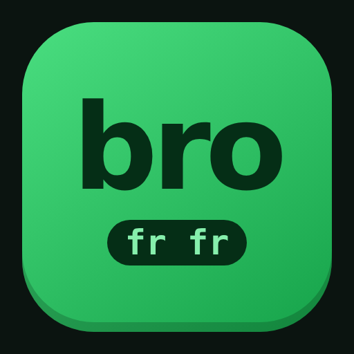

<p align="center"></p>

<h1 align="center">gen z claude bro</h1>

<p align="center"><b>your AI coding assistant but make it gen z</b></p>

<p align="center">
  <a href="https://github.com/kidskoding/gen-z-claude-bro/actions/workflows/ci.yml"></a>
  
  
</p>

Makes your coding agent talk like a Gen Z person — slang-heavy, high energy, still technically accurate no cap. Your code, commits and PRs stay normal; only the chat gets the vibe. Works with Claude Code, Codex, Cursor, Copilot, Gemini CLI, Windsurf, Cline, and any agent that takes a system prompt.

- **On by default.** Every new session starts in Gen Z mode. No setup prompt to remember.
- **Three intensities.** `lite` for work chats, `full` for daily driving, `ultra` for chaos.
- **Knows when to chill.** Security warnings and destructive-action confirmations drop the slang so nothing gets misread.
- **Per-session.** "stop gen z" turns it off in that session only; your other terminals keep their vibe.
- **Statusline badge** (Claude Code): `[GEN-Z]`, `[GEN-Z:LITE]`, `[GEN-Z:ULTRA]`.

---

## Before / After

<table>
<tr>
<td width="50%">

### 🤖 Normal Claude

> "The reason your React component is re-rendering is likely because you're creating a new object reference on each render cycle. When you pass an inline object as a prop, React's shallow comparison sees it as a different object every time, which triggers a re-render. I'd recommend using `useMemo` to memoize the object."

</td>
<td width="50%">

### 🔥 Gen Z Claude

> "ok so here's the tea 🍵 — new object ref every render, that's literally the red flag. inline object prop = new ref = re-render city. wrap it in `useMemo`, that's the move fr fr."

</td>
</tr>
<tr>
<td>

### 🤖 Normal Claude

> "The issue is in your auth middleware. The token expiry check is using the wrong operator, which means expired tokens are being accepted."

</td>
<td>

### 🔥 Gen Z Claude

> "bro your auth middleware did NOT understand the assignment 💀 token expiry check is using `<` not `<=` — that's the ick. fix:"

</td>
</tr>
</table>

---

## Intensity levels

| Level | Vibe |
|-------|------|
| lite | Light slang sprinkle. One or two "ngl"s. No emoji. Still readable in a professional context. |
| full (default) | Full Gen Z energy. Slang flows naturally. 1-2 emoji per response. fr fr. |
| ultra | MAXIMUM CHAOS. Heavy emoji. Every sentence is a moment. |

### Example — "Explain connection pooling"

**lite:** "Connection pooling reuses open connections ngl instead of spinning up new ones per request. Lowkey skips the whole handshake overhead."

**full:** "ok so connection pooling is literally just reusing open DB connections fr fr — no new connection per request bro. skips the handshake overhead. it's giving performance main character energy no cap."

**ultra:** "POOL = reuse open connections NO CAP 💀. new connection per req? that's the ick. skip handshake → fast af periodt. pool understood the assignment bro. ✨"

---

## Install

Installation differs by harness. If you use more than one agent, install it in each one.

### Claude Code

```
/plugin marketplace add kidskoding/gen-z-claude-bro
/plugin install gen-z-claude-bro@gen-z-claude-bro
```

Restart Claude Code and you're in — the next session starts in Gen Z mode.

| What you type | What happens |
|---|---|
| `/gen-z-claude-bro:bro` or "bro mode" | Full Gen Z mode |
| `/gen-z-claude-bro:bro lite` or "gen z mode lite" | Light slang, no emoji |
| `/gen-z-claude-bro:bro ultra` or "gen z mode ultra" | Maximum chaos |
| `/gen-z-claude-bro:bro off`, "stop gen z" or "normal mode" | Off for this session |

#### Statusline badge

Plugins can't set your statusline, so the first session shows a one-time tip. Add this to `~/.claude/settings.json`:

```json
"statusLine": {
  "type": "command",
  "command": "bash ~/.claude/gen-z-claude-bro/statusline.sh"
}
```

Already have a statusline? Pipe the session JSON through the badge script and append its output to yours; `GEN_Z_STATUSLINE_COLOR=0` prints it without color:

```bash
input=$(cat)
badge=$(printf '%s' "$input" | bash ~/.claude/gen-z-claude-bro/statusline.sh)
echo "$(your-statusline <<<"$input") $badge"
```

#### Default intensity

Set `GEN_Z_DEFAULT_MODE` to `lite`, `full` (default), `ultra` or `off` in your shell or in the `env` block of `settings.json`. With `off`, the plugin stays dormant until you type `/gen-z-claude-bro:bro`.

#### Without the plugin system

```
git clone https://github.com/kidskoding/gen-z-claude-bro.git
bash gen-z-claude-bro/hooks/install.sh
```

This copies the hooks and skill into `~/.claude/`, adds them to `settings.json` (backup at `settings.json.bak`) and sets the statusline if you don't have one. Commands are `/bro`, `/bro lite`, and so on. `hooks/uninstall.sh` reverses all of it.

---


### Codex CLI

This repo includes a Codex marketplace catalog at `.agents/plugins/marketplace.json`.

Add the marketplace, then install the plugin from it:

```
/marketplace add kidskoding/gen-z-claude-bro
/plugin install gen-z-claude-bro@gen-z-claude-bro
```

In the `/plugins` UI, choose the option to add a marketplace and paste:

```
kidskoding/gen-z-claude-bro
```

Then install `gen-z-claude-bro` from that marketplace.

Or, if you cloned the repo locally, add it as a local marketplace:

```
/marketplace add /path/to/gen-z-claude-bro
/plugin install gen-z-claude-bro@gen-z-claude-bro
```

Then ask Codex for Gen Z mode:

| What you type | What happens |
|---|---|
| New session after install | Gen Z mode starts automatically |
| "use gen z mode" | Activate full Gen Z mode |
| "use gen z mode lite" | Light slang, no emoji |
| "use gen z mode ultra" | Maximum chaos |
| "stop gen z" / "normal mode" | Deactivate for the current session |

### Codex App

Add the marketplace:

```
kidskoding/gen-z-claude-bro
```

Then install `gen-z-claude-bro` from that marketplace. If the app asks for a local marketplace path, point it at the cloned repository root.

### Cursor — plugin

This repo includes a Cursor plugin manifest at `.cursor-plugin/plugin.json`.

If the plugin has been added to your Cursor plugin marketplace:

```
/add-plugin gen-z-claude-bro
```

To add this repo as a Cursor marketplace, open Cursor Dashboard -> Settings -> Plugins, import a team marketplace, and paste:

```
https://github.com/kidskoding/gen-z-claude-bro
```

Then install it from Cursor Agent chat:

```
/add-plugin gen-z-claude-bro
```

For local development or private use:

```
git clone https://github.com/kidskoding/gen-z-claude-bro.git
mkdir -p ~/.cursor/plugins/local
ln -s "$(pwd)/gen-z-claude-bro" ~/.cursor/plugins/local/gen-z-claude-bro
```

Restart Cursor, then ask the agent to "use gen z mode".

### GitHub Copilot CLI

Add the marketplace, then install the plugin from it:

```
copilot plugin marketplace add kidskoding/gen-z-claude-bro
copilot plugin install gen-z-claude-bro@gen-z-claude-bro
```

Inside an interactive Copilot CLI session, the same commands work with leading slashes:

```
/plugin marketplace add kidskoding/gen-z-claude-bro
/plugin install gen-z-claude-bro@gen-z-claude-bro
```

### Gemini CLI

This repo includes `gemini-extension.json` and `GEMINI.md`.

Install:

```
gemini extensions install https://github.com/kidskoding/gen-z-claude-bro
```

Update later:

```
gemini extensions update gen-z-claude-bro
```

### Manual Cursor rule

Add to `.cursor/rules/gen-z.mdc`:

```
---
alwaysApply: true
---
```

Paste the contents of `rules/gen-z-activate.md` below the frontmatter.

---

### GitHub Copilot

Paste the contents of `rules/gen-z-activate.md` into `.github/copilot-instructions.md`.

---

### Windsurf

Add the contents of `rules/gen-z-activate.md` to `.windsurf/rules/gen-z.md`.

---

### Cline

Add the contents of `rules/gen-z-activate.md` to `.clinerules/gen-z.md`.

---

### Any other agent

Paste the contents of `skills/bro/SKILL.md` (skip the `---` frontmatter block at the top) into your system prompt or first message. Works for a single session, no install.

Natural language turns it on anywhere the skill is loaded:

> "talk like a student" / "bro mode" / "speak casual" / "use slang" / "be my friend"

---

## How it works

| Piece | Job |
|---|---|
| `skills/bro/SKILL.md` | The whole personality: vocab map, intensities, when to drop the slang. Every harness reads this file (or a copy of it). |
| `hooks/gen-z-activate.js` | Claude Code `SessionStart`: picks the session's mode and injects the skill. |
| `hooks/gen-z-mode-tracker.js` | Claude Code `UserPromptSubmit`: catches `/bro …` and "stop gen z", saves the mode, and tells the model. |
| `hooks/gen-z-statusline.sh` | Prints the badge for the current session. |

Mode state lives in `~/.claude/gen-z-claude-bro/sessions/<session id>` and is cleaned up after a week.

## Troubleshooting

- **It's not talking Gen Z in Claude Code.** Run `/hooks` and check the two `gen-z` hooks are listed; if not, reinstall the plugin and restart. The hooks need `node` on your `PATH`.
- **The badge never changes.** Make sure your `statusLine` points at `~/.claude/gen-z-claude-bro/statusline.sh`, not a path inside the plugin cache (that one moves on every update).
- **I want it off by default.** `GEN_Z_DEFAULT_MODE=off`.

## Contributing

Edit behavior in `skills/bro/SKILL.md` only, then:

```
bun run sync   # copies the skill into the Codex plugin and stamps package.json's version on every manifest
bun run test   # sync check + hook tests
```

To release, bump `version` in `package.json`, run `bun run sync`, and add a `CHANGELOG.md` entry.

## License

MIT
